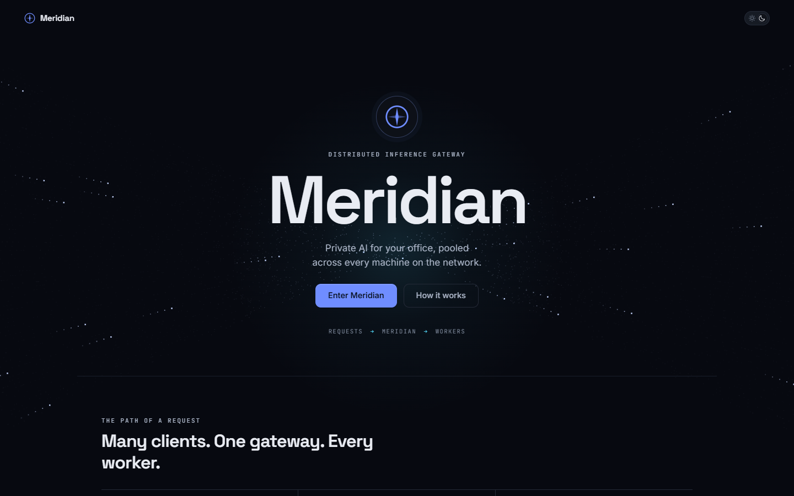
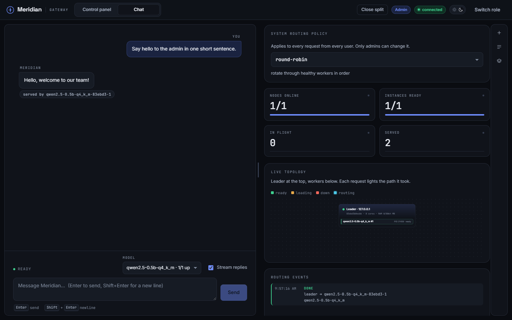
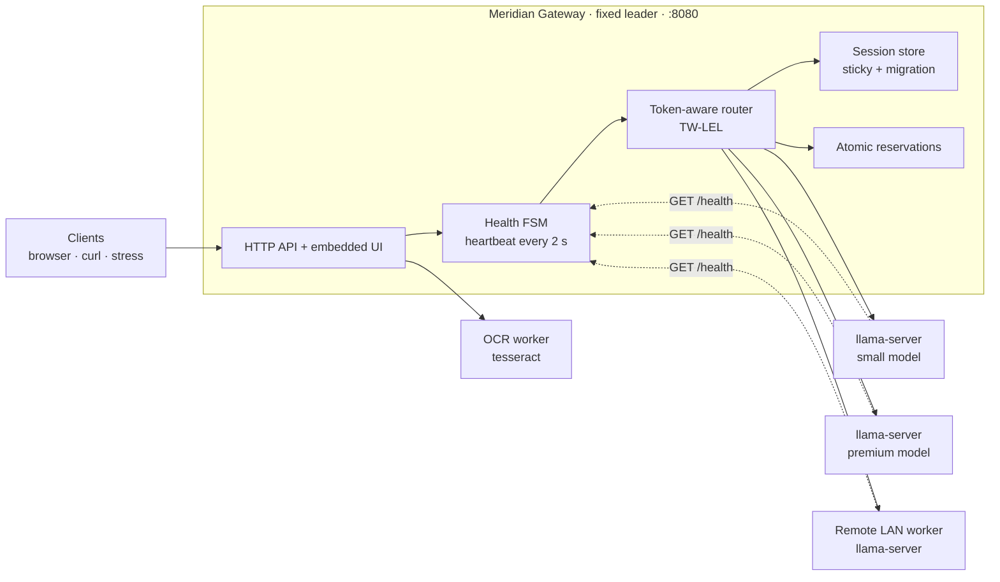

<div align="center">

# Meridian

**One private AI cluster from the machines you already own.**

A single Go binary that pools mismatched, unreliable LAN computers into one
local AI cluster — built for private **LLM chat**, **document extraction**, and
**OCR** without the cloud, Kubernetes, or a GPU budget.

<br>


<br>

> **Thesis:** Intelligent workload allocation between small and premium models
> can reduce deployment cost — RAM, latency, energy — without unacceptable
> quality loss.

</div>

<p align="center">
  
</p>

<p align="center">
  <sub>The embedded React UI: chat, document OCR, and live cluster status in a single binary.</sub>
</p>

---

## ✦ Why Meridian exists

Colleges, clinics, small offices, and home labs need private document and LLM
processing. They cannot leak data to the cloud, cannot justify a $2,000/month
GPU, and are often air-gapped. What they *do* have is a room full of idle,
mismatched PCs.

Standard serving tools fail this environment in three ways:

| Problem | What goes wrong |
|---|---|
| **Workload blindness** | `round-robin` and `least-connections` treat a 50-token `hi` and a 4,000-token document as one connection — and an 8 tok/s CPU the same as a 55 tok/s GPU. |
| **Node fragility** | Lab PCs sleep, disconnect, and crash mid-chat. Without health breakers, replay, and session migration, workflows break. |
| **Cost blindness** | Cloud routers optimise `tokens × price`. Locally the price is zero; the real costs are **RAM-seconds, latency, and energy**. |

Meridian is built for the opposite assumptions: **heterogeneous hardware,
unreliable nodes, zero cloud, and a human who needs an answer now.**

---

## ✦ What it does

| | |
|---|---|
| **Token-aware routing** | Every request goes to the worker with the lowest predicted finish time, using measured throughput, in-flight load, and the request's estimated input/output size. |
| **Fault tolerance** | A three-state health FSM, atomic reservations, session migration, one retry before headers, and supervised worker restarts with backoff. |
| **Single-binary gateway** | The Go gateway embeds the React UI. `meridian-stress` is a separate profiler. No Python, no Kubernetes, no external database. |
| **LLM + OCR together** | `llama-server` chat and `tesseract` OCR run concurrently under `/proc/meminfo` RAM admission. |
| **Fixed-leader cluster** | The first node in `cluster.yaml` is the leader. It heartbeats LAN workers and balances across local and remote nodes — no election, no Raft, no gossip. |
| **Honest observability** | `/status` exposes in-flight work, estimated tokens, measured tok/s, hosts, and sessions. JSONL logs contain no prompts, images, or OCR text. |

<p align="center">
  
</p>

<p align="center">
  <sub>Chat and cluster telemetry side by side — including the routing policy in effect.</sub>
</p>

---

## ✦ Architecture



- **Clients talk only to the leader.** Workers are stateless and answer `/health`.
- **Inference takes 35 s; the gateway takes <1 ms.** At LAN scale the leader is never the bottleneck.
- **Remote nodes run `llama-server` only.** No Meridian agent is installed on them.
- **Leader loss is documented, not hidden.** Models keep running; in-memory sessions are lost; recovery is a manual restart on the same or a standby machine.

### The routing score

For every healthy worker, Meridian computes a predicted finish time and picks
the lowest:

```text
C_w = (F_w · (I + Ō) + I + O) / R_w
```

| Symbol | Meaning |
|---|---|
| `F_w` | In-flight plus reserved requests on worker `w` |
| `I` | Estimated input tokens, including stored session history |
| `O` | Requested output tokens (`max_tokens`, or 128) |
| `Ō` | Per-model mean completed output tokens (128 before any data) |
| `R_w` | Measured throughput in tokens/second |

A worker is excluded when `I + O` exceeds its per-slot context
(`ctx / parallel`). If no worker fits, the gateway returns
`413 context_too_long`.

> **Known limitation:** this is a whiteboard-explainable heuristic, not an exact
> queueing model. It assumes queued requests are as large as the new one, and
> that input and output tokens cost the same. Continuous batching means
> throughput does not fall linearly with load.

---

## ✦ Quickstart

**Requirements:** Go 1.22+, a `llama-server` binary, and GGUF model files.
Node 18+ is needed only when rebuilding the web UI. Tesseract is optional.

```bash
# from the repository root
make build      # web UI + meridian-server + meridian-stress
# or
make server     # use the committed web build, skip Node
```

### Single machine — Phase 1

```bash
./bin/meridian-server serve \
  --llm qwen2.5-0.5b-instruct-q4_k_m.gguf:2 \
  --llm qwen2.5-3b-instruct-q4_k_m.gguf:1 \
  --llama-bin /usr/local/lib/ollama/llama-server \
  --models-dir ~/meridian/models \
  --threads 8 --ctx 4096 --host 0.0.0.0 --port 8080 \
  --ram-headroom-mb 256 --routing-policy token-aware
```

The number after `:` is the instance count. Preflight rejects the start if
`instances × model size + headroom` exceeds `MemAvailable`.

Open **<http://localhost:8080>** for the embedded UI.

### Fixed leader + LAN workers — Phase 3

Once Phase 3 lands, the leader and a sub-node are configured like this:

```bash
# Leader: the first node listed in configs/cluster.yaml
./bin/meridian-server serve --cluster-config configs/cluster.yaml
```

```bash
# Sub-node: llama-server only, no Meridian agent
llama-server --host 0.0.0.0 --port 8081 \
  -m model.gguf --alias MODEL -t 4 -c 4096 -np 2
```

A remote worker failure is detected in roughly **6 seconds** (3 × 2 s probes).
The same token-aware policy sees local and remote workers identically.

### Benchmark it

```bash
./bin/meridian-stress \
  --addr http://127.0.0.1:8080 \
  --concurrency 6 \
  --conversations-per-model 20

curl http://127.0.0.1:8080/status
```

### Verify the build

```bash
go test ./...
go vet ./...
go test -race ./internal/balancer ./internal/ml
npm --prefix web run typecheck
```

---

## ✦ API surface

| Method | Endpoint | Purpose |
|---|---|---|
| `POST` | `/v1/chat/completions` | OpenAI-compatible chat, streaming or not |
| `GET` | `/v1/models` | Models with at least one healthy worker |
| `GET` | `/status` | Per-worker load, tok/s, host, sessions |
| `GET` | `/policies` | Available routing policies |
| `PUT` | `/v1/policies/default` | Change the default policy at runtime |
| `GET` | `/healthz` | Liveness |
| `GET` | `/v1/catalog` | Model catalog |
| `POST` | `/v1/ocr` | OCR one PNG/JPEG image |
| `GET` | `/ml/status` | OCR state and RAM admission |
| `POST` | `/v1/document/analyze` | OCR → LLM extraction _(Phase 3, if built)_ |

**Useful headers:** `X-Conversation-ID` for session affinity,
`X-Meridian-Routing-Policy` to pin a single request, and
`X-Meridian-Failover` for failover behaviour.

Policies: `round-robin`, `random`, `least-connections`, `token-aware`.
`cost-aware` is planned for Phase 2.

```bash
curl http://localhost:8080/v1/chat/completions \
  -H 'Content-Type: application/json' \
  -H 'X-Conversation-ID: demo-1' \
  -d '{"model":"qwen2.5-0.5b","messages":[{"role":"user","content":"Hello"}]}'
```

---

## ✦ Roadmap

| Phase | Focus | Status |
|:---:|---|---|
| **0** | Trim the fat — remove arbiter/SD/stubs, keep LLM + OCR, green build | ✅ Complete |
| **1** | Single-machine fault tolerance — kill a worker, chats continue | ✅ Complete |
| **2** | Small vs premium routing — `complexity.go`, `cost_aware.go`, cost/quality proof | ⏳ Next |
| **3** | Fixed leader + LAN workers — heartbeat and balance remote nodes | ◻ Planned |
| **4** | Evidence — experiments, graphs, pitch, report | ◻ Planned |

**Current status:** Phase 1 is implemented. Token-aware routing (`TW-LEL`) is
implemented, tested, and visualised in the UI. Worker heartbeats and local load
balancing already exist. `complexity.go` and `cost_aware.go` are not built yet;
Phase 2 benchmarks remain to be run. Phase 3 extends the existing heartbeat and
balancer to remote workers — it adds no election.

---

## ✦ Design decisions, viva-ready

| Decision | Rationale |
|---|---|
| **Fixed leader, no consensus** | With one leader and 2–5 nodes, Raft or gossip costs more than it gains. The failure mode is simple to explain and simple to recover. |
| **Multiple instances of small models** | A 0.5–1.5B model may run twice under RAM admission: full context each, crash isolation, independent scheduling. Large models use one instance with `-np` slots. |
| **Session stickiness** | A conversation stays on its worker while healthy; on failure it migrates and the client resends history. |
| **Atomic reservations** | Capacity is reserved before forwarding, so concurrent requests cannot oversubscribe a worker. |
| **Supervised restarts** | A crashed `llama-server` restarts with exponential backoff (1 s → 30 s), up to 5 consecutive failures. A run lasting ≥1 minute resets the counter. |
| **RAM admission** | `/proc/meminfo` headroom is checked before starting workers. Preflight refuses configurations that would overcommit the host. |
| **Zero-PII logs** | Metrics capture latency, tokens, worker, and status — never prompts, images, or OCR text. |

### Small vs premium (Phase 2, planned)

- **Tiers:** `qwen2.5-0.5b` (fast, cheap) vs `qwen2.5-1.5b/3b` (quality).
- **Classifier:** input >1,500 tokens or keywords such as `summarize`, `extract`,
  `code`, `invoice` → premium; otherwise small. Default small, escalate on
  `413` or empty output.
- **Score:** `EstimatedWait + λ × premiumPenalty` — one tunable,
  whiteboard-explainable rule.
- **Cost:** RAM-GB × seconds. **Quality proxy:** 1–5 manual rating on 20 fixed
  prompts.

---

## ✦ Known limitations

Meridian is deliberately honest about what it does not do:

- No authentication or TLS — **trusted LAN only**.
- The fixed leader is a single point of failure; recovery is a manual restart.
- No node-level heartbeat yet, so `/status` cannot distinguish “machine off”
  from “`llama-server` crashed”.
- Sessions are in memory and lost on leader restart.
- Token estimates are approximate (~4 characters/token).
- Token-aware routing is a heuristic, not an exact queueing model.
- Streams cannot resume mid-token; the next turn reroutes with history intact.
- No image generation, fine-tuning, cloud APIs, or multi-GPU clusters.
- Phase 2 small-vs-premium routing and cost-aware scheduling are not built yet.

---

## ✦ Repository layout

```text
cmd/
  meridian-server/   Gateway (serve | ml-worker) — leader
  meridian-stress/   p50/p95/p99, tok/s, fault injection
internal/
  api/               OpenAI-compatible + worker contracts
  balancer/          pool, session, routing, handler, supervisor
                     token_aware.go · stream_usage.go
                     + cost_aware.go, complexity.go   (Phase 2)
  tokens/            O(n) estimator (~4 chars/token)
  ml/                OCR supervisor, tesseract/fake, RAM admission
  metrics/           JSONL telemetry — no PII
  webui/             go:embed all:dist
web/                 React 19 + TypeScript + Vite
configs/
  ml.yaml            fake OCR (tests)
  laptop-real.yaml   real tesseract OCR
  cluster.yaml       Phase 3 worker list (leader = first node)
docs/
  00-overview-and-roadmap.md
  01-phase-0-trim-the-fat.md
  02-phase-1-single-machine-fault-tolerance.md
  03-phase-2-intelligent-workload-allocation.md
  04-phase-3-leader-multi-node-distribution.md
  05-phase-4-test-pitch-and-report.md
  archive/           superseded audits and implementation notes
```

---

## ✦ Documentation

| Document | What it covers |
|---|---|
| [`docs/00-overview-and-roadmap.md`](docs/00-overview-and-roadmap.md) | Product claim and phase order — read first |
| [`docs/01-phase-0-trim-the-fat.md`](docs/01-phase-0-trim-the-fat.md) | Phase 0 deletions and acceptance criteria |
| [`docs/02-phase-1-single-machine-fault-tolerance.md`](docs/02-phase-1-single-machine-fault-tolerance.md) | Fault tolerance acceptance criteria |
| [`docs/03-phase-2-intelligent-workload-allocation.md`](docs/03-phase-2-intelligent-workload-allocation.md) | Small vs premium routing |
| [`docs/04-phase-3-leader-multi-node-distribution.md`](docs/04-phase-3-leader-multi-node-distribution.md) | Fixed leader + LAN workers |
| [`docs/05-phase-4-test-pitch-and-report.md`](docs/05-phase-4-test-pitch-and-report.md) | Experiments, graphs, pitch |
| [`docs/project-report.md`](docs/project-report.md) | Full project report |
| [`docs/spec-leader-worker-cluster.md`](docs/spec-leader-worker-cluster.md) | Leader/worker protocol specification |
| [`docs/deployment.md`](docs/deployment.md) | Deployment notes |
| [`docs/ui-redesign/REPORT.md`](docs/ui-redesign/REPORT.md) | UI redesign report and screenshots |

---

<div align="center">

**Meridian** — because the fastest AI cluster is the one already sitting in the room.

<sub>Built with Go, React, llama.cpp, and Tesseract. No cloud required.</sub>

</div>
