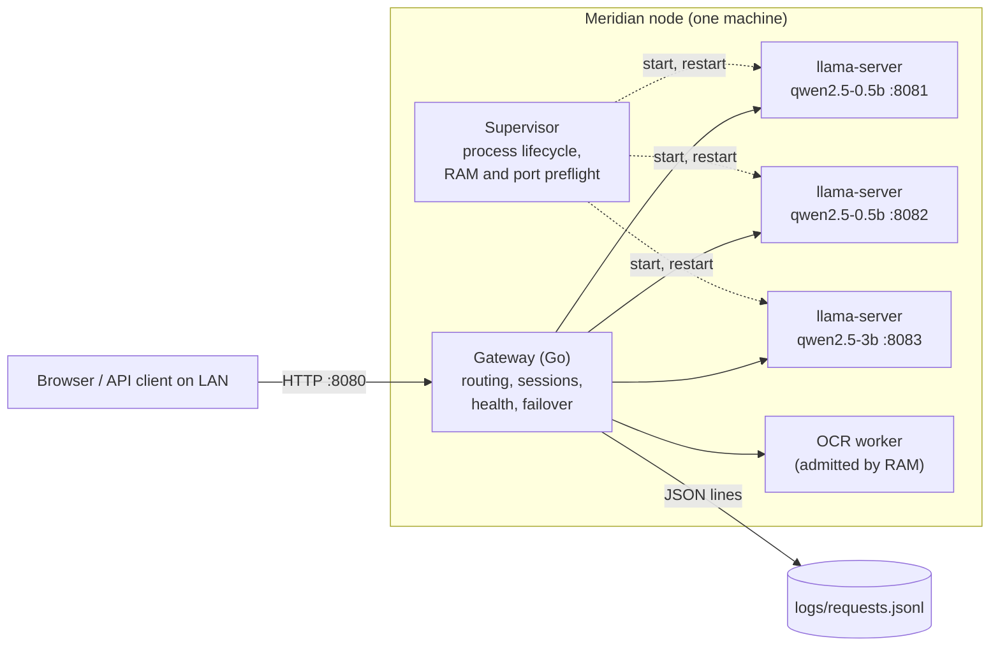
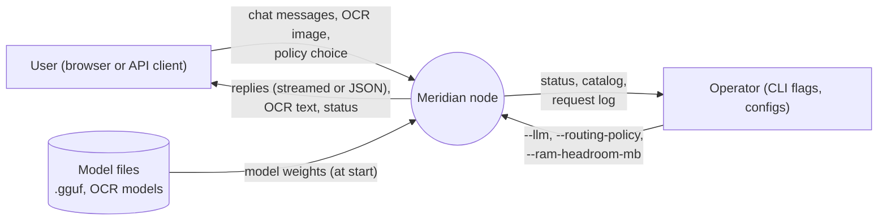
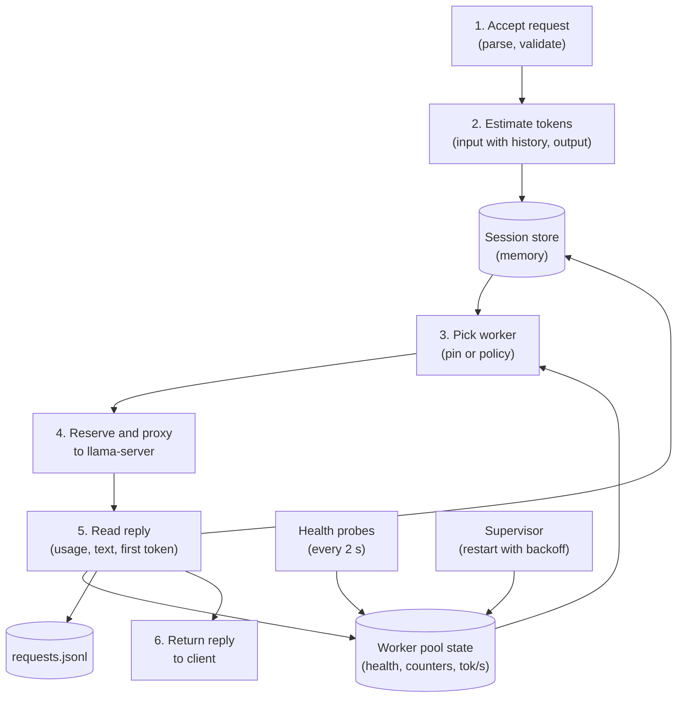
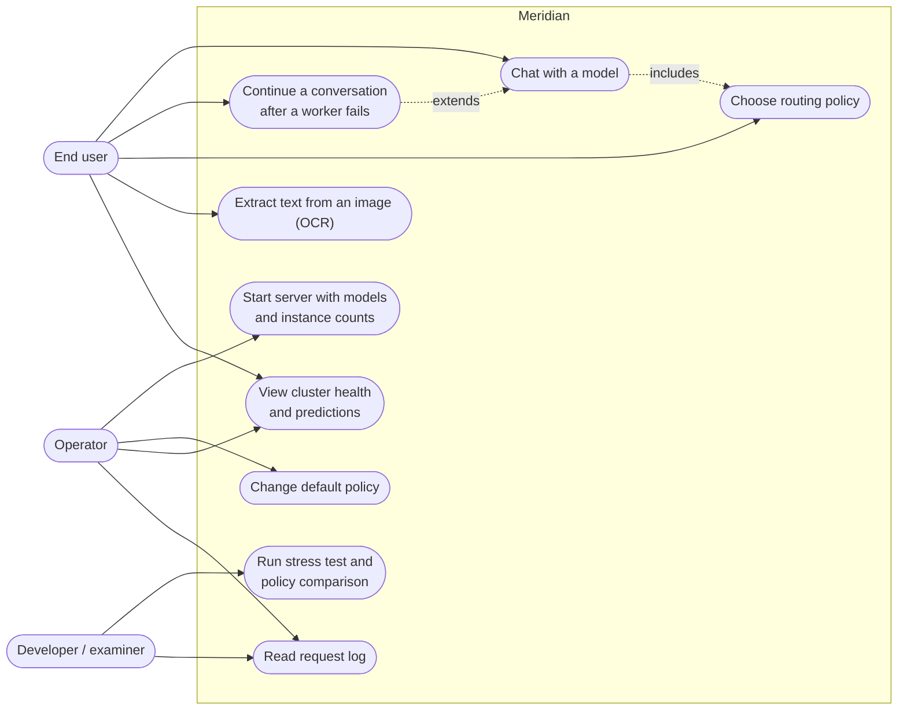
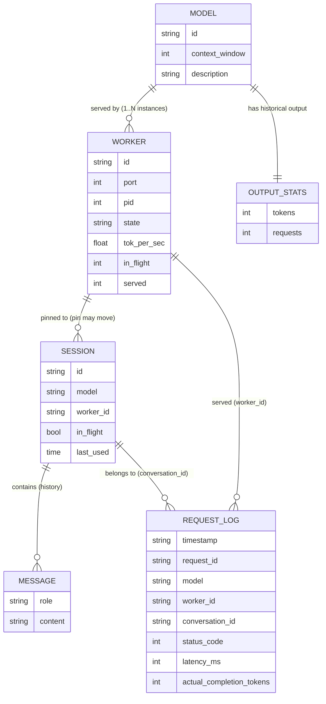
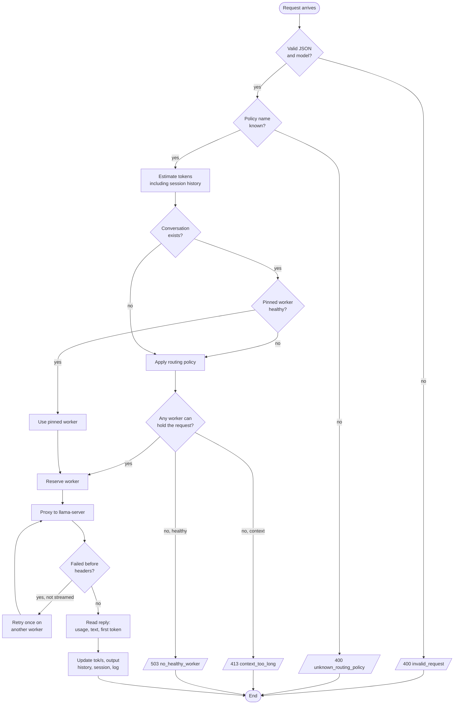
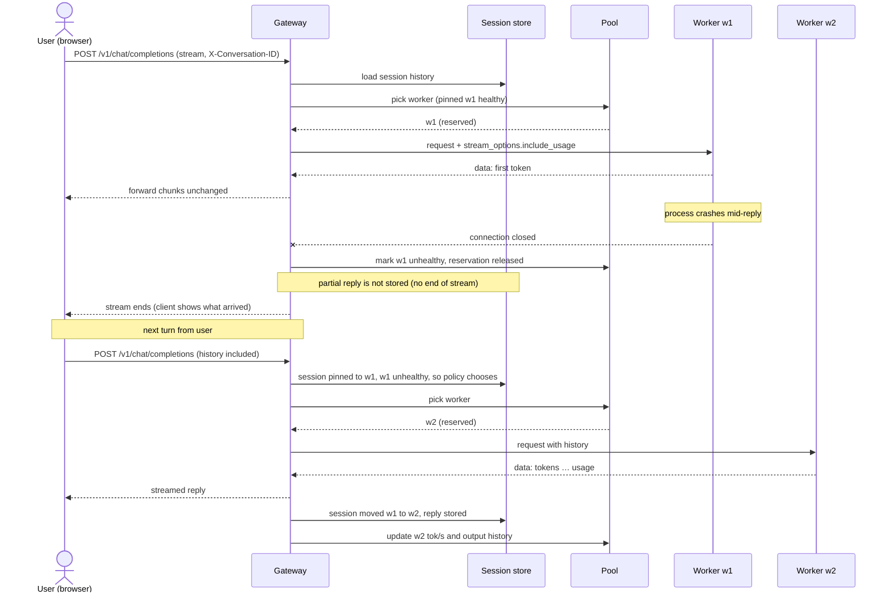
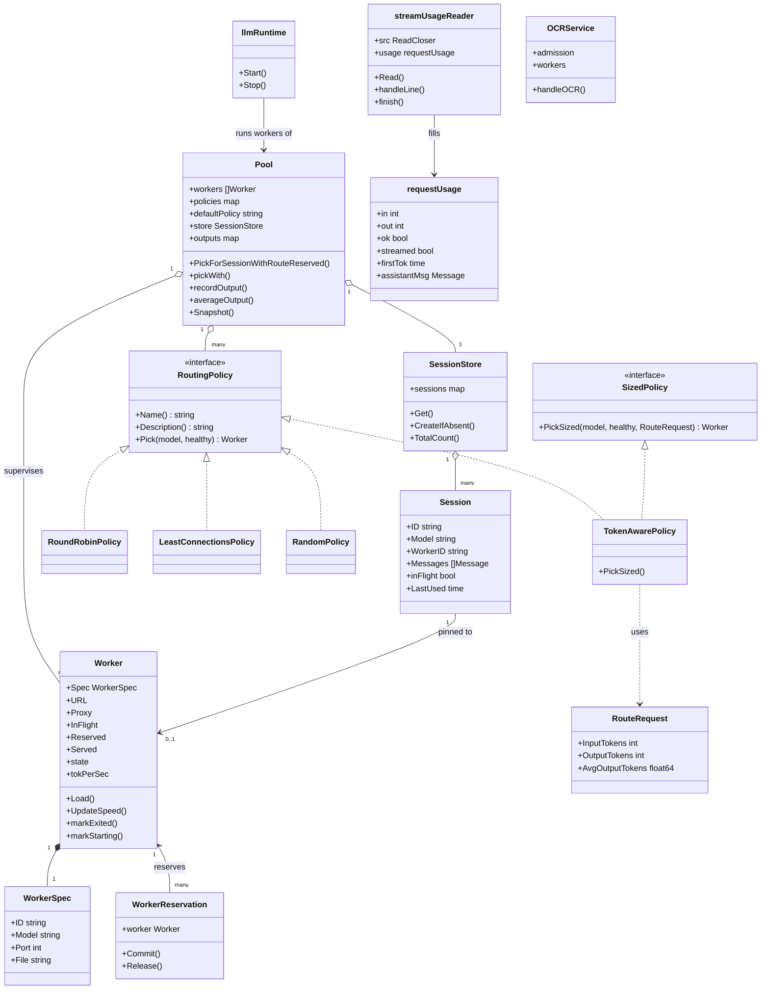

# Meridian: Project Analysis and System Report

Meridian is a private AI gateway for small offices, colleges, clinics, and home labs. It runs local
GGUF language models and document OCR on ordinary PCs and laptops, behind one OpenAI-compatible HTTP
API and a built-in web interface. It is one Go binary with the React UI embedded in it. No cloud
service and no Python runtime are required.

**Status:** Phase 0 (trim) and Phase 1 (single-machine fault tolerance) are implemented. Token-aware
routing is implemented. The small-versus-premium classifier and the multi-node cluster are planned.
Sections that describe unfinished work say so.

---

## 1. ANALYSIS

### 1.1 Problem

Organisations that handle sensitive documents often cannot send them to a cloud AI service, and they
cannot justify a dedicated GPU server. Most already own several idle, mismatched PCs and laptops.
Existing tools handle that setting poorly:

| Gap | Effect |
|---|---|
| Generic balancers (round-robin, least-connections) ignore request size and hardware speed | A 50-token greeting and a 4,000-token document count as one connection. An 8 tok/s CPU and a 55 tok/s GPU get equal shares. Baseline on this workload: p50 35 s, p95 234 s (`stress-results.json`). |
| Single-host runners (Ollama) have no failover | A crashed model process ends the chat. |
| Cloud-cost tools (LiteLLM) optimise dollars | Locally the marginal cost is zero, so RAM and latency matter instead. |
| Cluster frameworks (Ray Serve, Kubernetes) need Python or cluster administration | Too heavy for a lab with three PCs. |

### 1.2 Stakeholders

- **Operator:** sets up the node, picks models and instance counts, watches health.
- **End user:** chats with a model, or extracts text from a scanned document, in a browser.
- **Developer or examiner:** verifies routing, fault tolerance, and measured performance.

### 1.3 Requirements

**Functional**
- F1. Serve several GGUF models at once, each with an operator-chosen instance count (`--llm file.gguf:N`).
- F2. OpenAI-compatible chat completions, streamed and non-streamed.
- F3. Keep conversation history across turns, including when the serving worker changes.
- F4. Route each request by policy: round-robin, random, least-connections, or token-aware.
- F5. Detect a crashed worker, stop routing to it, restart it, and move affected conversations.
- F6. Document OCR (PNG or JPEG in, text and lines out), admitted only when RAM allows.
- F7. A web UI showing worker health, throughput, sessions, in-flight load, and OCR status.

**Non-functional**
- N1. One binary; the only external runtime dependency is `llama-server`.
- N2. Gateway overhead far below inference time.
- N3. Refuse to start when the configured instances would not fit in available RAM.
- N4. Usable from any device on the LAN.
- N5. No message content in logs (conversation IDs and token counts only).

### 1.4 Success criteria

- Kill one worker during chats: at least 95% of non-streamed requests succeed, and history survives the move (Phase 1 acceptance).
- Token-aware routing: p95 latency below round-robin under the same load (Phase 2, to be measured).

---

## 2. DEFINITION

**Meridian** is a self-hosted gateway that turns ordinary machines into a private AI serving node.
For each request it picks a worker, watches the worker's health, and keeps the conversation going
when a worker fails. It serves two workloads:

- **LLM chat:** each model runs as one or more `llama-server` (llama.cpp) processes.
- **Document OCR:** a separate OCR worker, admitted by RAM, outside the LLM pool.

**Thesis under test:** intelligent workload allocation can cut the RAM, latency, and energy cost of
local AI without unacceptable quality loss.

**Scope:** the single-machine node (Phases 0 and 1, plus token-aware routing). The multi-node design
is a future extension (§16.1).

---

## 3. DESCRIPTION

### 3.1 What a user sees

1. The operator starts the server with one `--llm` flag per model.
2. Clients open `http://<node-ip>:8080/` in a browser.
3. The chat page lists models with healthy-worker counts. The user picks a model and a routing policy,
   then chats. Replies stream in and show which worker served them.
4. The cluster panel shows each worker's state, tokens per second, in-flight requests, served count,
   and predicted finish time. Under token-aware routing the next worker is highlighted.
5. The OCR tab takes an image and returns text with line confidence.

### 3.2 One request, end to end

1. The gateway reads the request and estimates input tokens (about 4 characters per token, plus
   template overhead) and output tokens (`max_tokens`, default 128).
2. A session's pinned worker is used if there is one. Otherwise the routing policy chooses among
   healthy workers that can hold the request.
3. The worker is reserved, the request is proxied, and the answer is recorded.
4. For a streamed reply, bytes are forwarded unchanged while the final usage chunk and the reply text
   are read. The reply is stored in the session for later turns.
5. The worker's measured tokens per second and the model's output-length history are updated.

### 3.3 Components

| Component | Location | Role |
|---|---|---|
| Gateway | `internal/balancer/handler.go` | HTTP API, request lifecycle, failover |
| Pool | `internal/balancer/pool.go` | Workers, reservations, health, output history |
| Routing policies | `routing.go`, `least_conn.go`, `random.go`, `token_aware.go` | Choose a worker |
| Sessions | `session.go` | Conversation history and worker pinning |
| Streaming reader | `stream_usage.go` | Reads SSE output without changing it |
| Supervisor | `supervisor.go`, `runtime.go` | Preflight, process start and restart, shutdown |
| OCR service | `internal/ml` | Admission, OCR workers, HTTP handler |
| Request log | `internal/metrics` | JSONL request log |
| Token estimate | `internal/tokens` | Rough input and output token counts |
| Web UI | `web/` (embedded from `internal/webui/dist`) | React and TypeScript interface |
| Stress tool | `cmd/meridian-stress` | Multi-turn load tests and policy and concurrency sweeps |

---

## 4. LIMITATIONS

**Technical**
- **Single leader, in-memory state.** Sessions live in gateway memory and are lost on restart. The
  UI keeps its own chat history in browser storage and sends the full history on every turn, so the
  chat itself survives a gateway restart.
- **Capacity.** At most 200 sessions. A session is dropped after 30 minutes without use.
- **CPU-only by default.** The documented start command sets `--ngl 0`. The MX550 (2 GB VRAM) is not
  used until a CUDA-enabled `llama-server` is confirmed. A 3B model does not fit in 2 GB of VRAM.
- **GPU offload applies by position, not by model.** `--ngl` and `--gpu-workers` apply to the first N
  workers in start order, so the operator must order the `--llm` flags.
- **Token estimate is rough.** Input tokens come from a 4-characters-per-token rule. Routing decisions
  are approximate; actual usage is logged for comparison.
- **Heuristic routing score.** The token-aware score assumes queued requests are as large as the new
  one and that input and output tokens cost the same. Continuous batching makes throughput
  non-linear in load.
- **Throughput needs a warm-up.** Every worker starts at 20 tokens per second and learns from real
  replies. Early measurements are unreliable.
- **No mid-token resume.** If a worker dies during a streamed reply, that reply is lost. The next
  turn is routed elsewhere with the history intact. A non-streamed request gets one automatic retry
  if it fails before any response headers are sent.
- **Streamed throughput depends on llama-server.** It needs `stream_options.include_usage`. Without
  it the gateway cannot read the token count, so throughput is not updated and the log shows
  `act_out=?`.
- **Thread oversubscription is a configuration risk.** `--threads` applies to each worker. If the sum
  across workers exceeds the physical cores, latency rises sharply.
- **Restart limit.** A worker that fails more than `--max-restarts` (default 5) times in a row stays
  down until the server restarts.

**Security and operations**
- No authentication and no TLS. Use only on a trusted LAN or behind a reverse proxy.
- `PUT /v1/policies/default` is unauthenticated.
- The OCR endpoint has no documented size limit in this report. Set one before exposing it.

**Product**
- No image generation or model fine-tuning.
- The small-versus-premium classifier and the cost-aware policy (Phase 2) are not built.
- The multi-node cluster (Phase 3) is not built.
- Chat replies are shown as plain text with line breaks; Markdown is not rendered.
- The UI has been checked against the live API. It has not been reviewed visually on every target device.

---

## 5. PROPOSED SYSTEMS

| Option | Description | Verdict |
|---|---|---|
| A. Ollama on each PC, manual choice | Users pick a machine by hand | No failover, no shared view, no RAM admission. Rejected. |
| B. Generic reverse proxy (NGINX, HAProxy) in front of `llama-server` processes | Standard balancing | Ignores request size and speed, no session migration. Rejected. |
| C. Cluster framework (Ray Serve, Kubernetes model server) | Full distributed platform | Needs Python or cluster administration. Too heavy. Rejected. |
| **D. Meridian: one Go gateway with a policy engine and a process supervisor** | Supervises local workers and routes by size and speed | **Chosen.** Small, explainable, fits low-end hardware. |

Within option D, the **token-aware** policy (§10.5) was chosen over simpler policies because it uses
measured speed and queued work, and its formula can be explained on a whiteboard.

---

## 6. FEASIBILITY STUDY

### 6.1 Technical

- **Stack:** Go standard library for HTTP, process supervision, and JSON; React and TypeScript for the
  UI, built with Vite and embedded with `go:embed`. No Python.
- **Inference engine:** `llama-server` from llama.cpp, already installed on the target machines.
- **Exercised paths:** single-retry failover, session migration, streamed chat with full history, and
  a two-instance start that passed the RAM check.
- **Open risk:** GPU offload needs a CUDA-enabled `llama-server`. The MX550 can hold the 0.5B model
  but not the 3B models.

### 6.2 Operational

- **Target hardware:** Intel i5-12th-gen H-series laptop (12 physical cores, 16 threads), 16 GB RAM,
  MX550 (2 GB VRAM).
- **Memory is the binding constraint.** Preflight refuses to start when
  `sum(model file sizes) + headroom > MemAvailable`. In one test, two 0.5B instances needed 2131 MB
  while 1859 MB was free, so the server refused to start.
- Browser tabs held most of the machine's memory during testing. Operators must close them before
  starting a large model set.

### 6.3 Economic

- Software cost is zero: Go, React, and llama.cpp are open source.
- No hardware purchase is needed beyond existing machines.
- Running cost is the electricity for idle and loaded machines. The cost model (RAM-GB × seconds) is
  defined in the Phase 2 plan but not yet measured.

### 6.4 Schedule

Phases 0 and 1 are complete and Phase 2 is partly complete. Phases 3 and 4 are planned. The remaining
work is measurement and documentation, not new architecture.

### 6.5 Conclusion

The project is feasible on existing hardware for a single node. Multi-node operation is feasible in
principle but is deferred until single-node measurements exist.

---

## 7. PROJECT PLANNING

### 7.1 Goals

1. A single-node gateway that serves several models with fault tolerance.
2. Routing that uses request size and measured speed.
3. Measured evidence: cost and latency with and without intelligent routing.
4. A reproducible test suite and benchmark.

### 7.2 Work breakdown

| Phase | Goal | Status |
|---|---|---|
| 0. Trim | Remove unused subsystems (arbiter, image generation, TUI); LLM and OCR only | Done |
| 1. Single-machine fault tolerance | Health states, atomic reservations, failover, session migration, tokens-per-second metric, multi-model start with RAM admission, worker restart with backoff | Done |
| 2. Workload allocation | Token-aware routing (TW-LEL), policy selection in the UI, streamed throughput, policy comparison in the stress tool | Token-aware done. Classifier and cost-aware policy not built. Benchmarks pending. |
| 3. Leader and sub-nodes | Cluster configuration, remote workers, standby leader | Planned (§16.1) |
| 4. Evidence | Four experiments, charts, pitch, report chapter | Planned |

---

## 8. SOFTWARE PROJECT PLANNING

### 8.1 Approach

The plan follows `CONTEXT.md`. Each phase has a file in `docs/`, a completion condition, and a rule:
run `go test` and `go vet`, commit, then start the next phase. No phase starts on a red build.

### 8.2 Effort by area (qualitative)

| Area | Share | Notes |
|---|---|---|
| Gateway, routing, fault tolerance | Largest | Health state machine, reservations, sessions, streaming reader |
| Supervisor and preflight | Medium | Process lifecycle, RAM and port checks, restart with backoff |
| Web UI | Medium | Rebuilt from scratch, then extended with policy and prediction views |
| Testing and stress tooling | Medium | Unit tests per package, policy and concurrency sweeps |
| Documentation | Small | Context file, phase files, this report |

### 8.3 Milestones

- **M1 (complete):** Phase 0 build green; `go test` passes for balancer, ML, and CLI packages.
- **M2 (complete):** a worker can be killed during a chat and the chat continues.
- **M3 (in progress):** token-aware routing and the policy sweep exist; the measured comparison is pending.
- **M4 (planned):** Phase 2 benchmark, cost model, and quality check.

### 8.4 Tools

- Go toolchain: `go vet`, `go test -race`, `gofmt`.
- Node and npm for the UI build (Vite, TypeScript).
- Git, work on the `experimental` branch.
- `make server` builds the Go binaries; `make build` also builds the UI.

---

## 9. PROJECT TRACKING AND SCHEDULING

### 9.1 Tracking

- Progress is tracked against the phase table (§7.2) and the acceptance checklist in each phase file.
- Test status: `go test -race ./internal/balancer ./internal/ml ./cmd/...` and `go vet ./...`.
- Runtime health: `/status` and the cluster panel.

### 9.2 Schedule (in order)

1. Confirm the llama-server build and its GPU support on the target laptop.
2. Run the policy sweep, with a warm-up first, and record `stress-results-matrix.json`.
3. Run the Phase 1 kill test and record the success rate.
4. Build the Phase 2 classifier only if the policy comparison shows a need.
5. Write the cost model and quality check (Phase 2 tasks 3 and 4).
6. Evidence and report (Phase 4).

### 9.3 Risks

| Risk | Likelihood | Response |
|---|---|---|
| RAM too small for the planned model set | High on the current laptop | Preflight refuses to start; operator lowers instance counts |
| Thread oversubscription makes latency worse | Medium | Size `--threads` to physical cores divided by worker count |
| Token-aware routing does not beat round-robin | Medium | Report the result as measured; the sweep shows where it helps |
| llama-server build lacks streamed usage | Medium | Fall back to non-streamed measurement |
| Browser memory pressure during tests | High | Close tabs before benchmarks; record free RAM with results |

---

## 10. SYSTEM DESIGN

### 10.1 DEFINITION

The system has four cooperating parts:

- **Pool:** the workers, their state and counters, and the output history.
- **Policies:** choose one worker from the eligible set.
- **Sessions:** conversation memory and worker pinning.
- **Handler:** the request lifecycle (read, estimate, pick, proxy, record).

Architecture:



Layers:

| Layer | Responsibility | Depends on |
|---|---|---|
| Interface | HTTP API, embedded UI, CLI flags | Balancer, ML |
| Routing | Policy choice, eligibility, reservation | Pool, workers |
| State | Sessions, worker state, output history | Memory |
| Process | Start, restart, stop child processes | OS, `llama-server` |
| Measurement | Request log, throughput, token estimate | Filesystem |

### 10.2 OUTPUT DESIGN

**Chat responses** follow the OpenAI chat-completions shape. Streamed replies are server-sent events
(`data: {...}` lines, ending with `[DONE]`).

**Headers added by the gateway**

| Header | Meaning |
|---|---|
| `X-Meridian-Worker` | Worker that served the request (e.g. `w1`) |
| `X-Meridian-Model` | Model used |
| `X-Meridian-Routing-Policy` | Policy that picked the worker |
| `X-Meridian-Failover` | `w1->w2` when a retry moved the request |
| `X-Meridian-Est-Input-Tokens`, `-Output-`, `-Total-` | The gateway's token estimate |

**Errors** use one shape: `{"error": {"message": "...", "type": "..."}}`.

| Status | Type | When |
|---|---|---|
| 400 | `invalid_request` | Body is not JSON, or `model` missing |
| 400 | `unknown_routing_policy` | Policy name not registered |
| 400 | `model_mismatch` | Conversation bound to another model |
| 404 | `model_not_found` | No worker serves this model |
| 409 | `conversation_busy` | Same conversation sent twice at once |
| 413 | `context_too_long` | Request does not fit any worker's per-slot context |
| 502 | `upstream_error` | Worker failed and no retry was possible |
| 503 | `no_healthy_worker` | Every worker for the model is down or starting |

**Status payloads**
- `GET /status`: per worker `id`, `model`, `port`, `pid`, `state`, `healthy`, `in_flight`, `served`,
  `est_tokens_in_flight`, `tok_per_sec`, `consecutive_failures`, `last_check`, `last_error`,
  `sessions`; and `sessionCount`.
- `GET /v1/catalog`: `llm` and `ml` model lists with healthy-worker counts, `routing_policies`,
  `default_routing_policy`.
- `GET /ml/status`: OCR `enabled`, `models`, `workers` (`served`, `failed`, `restarts`,
  `last_inference_ms`), `resources` (RAM available, reserved, headroom in MB).
- `POST /v1/ocr`: `request_id`, `model`, `text`, `lines` (text, confidence, box), `processing_ms`.

**Stress-test output:** console summary (success rate, p50/p95/p99, per-turn latency, requests and
tokens per second, requests per worker, the policy the server reported). Sweeps add a comparison table
and `stress-results-matrix.json`.

### 10.3 INPUT DESIGN

**Server flags** (`meridian-server serve`)

| Flag | Default | Purpose |
|---|---|---|
| `--llm <file>[:N]` | required | Model file and instance count; repeat per model |
| `--models-dir` | `~/models` | GGUF directory |
| `--llama-bin` | `llama-server` | Worker binary |
| `--threads` | 4 | Threads per worker |
| `--ctx` | 8192 | Context per worker |
| `--parallel` | 2 | Slots per worker |
| `--ngl`, `--gpu-workers`, `--gpu-device` | 0, 1, empty | GPU offload |
| `--routing-policy` | `round-robin` | Default policy |
| `--ram-headroom-mb` | 1024 | RAM kept free after admission |
| `--restart-workers` | true | Restart crashed workers |
| `--max-restarts` | 5 | Consecutive failed restarts before giving up |
| `--host`, `--port` | `0.0.0.0`, 8080 | Listen address |
| `--enable-ml`, `--ml-config` | false, `configs/ml.yaml` | OCR subsystem |

**Stress-tool flags** (`meridian-stress`): `--addr`, `--concurrency`, `--concurrencies` (sweep),
`--policies` (comparison), `--conversations-per-model`, `--cooldown`.

**HTTP inputs**
- `POST /v1/chat/completions`: JSON with `model`, `messages`, optional `max_tokens` and `stream`.
  Body limit 1 MiB.
- Headers: `X-Conversation-ID` (session key), `X-Meridian-Routing-Policy` (per-request policy),
  `X-Request-ID` (logging).
- `PUT /v1/policies/default`: `{"name": "..."}`.
- `POST /v1/ocr`: multipart with `file` (PNG or JPEG) and optional `model`.

**Validation:** `--llm` counts must be positive integers; unknown policy names are rejected; preflight
checks model files, worker ports, the llama-server binary, and RAM. The UI requires a non-empty
message and a selected model before sending.

### 10.4 LOGICAL DESIGN

**Worker states.** `starting` → `healthy` ↔ `unhealthy`. A worker starts in `starting` and gets 180 s
to become ready. Three consecutive failed probes make a healthy worker `unhealthy`. A worker whose
process exits is marked `unhealthy` immediately. Health is probed every 2 s by calling `/health` with
a 2 s timeout.

**Reservations.** A short claim made between selection and proxying. Commit moves it to in-flight;
Release drops it if the request never starts.

**Sessions.** One conversation: model, pinned worker, message history, an in-flight flag (a concurrent
request gets `409`), and the last-used time.

**Routing rules**
1. Only healthy workers of the requested model are candidates.
2. For size-aware policies, a worker is excluded if `input + output > per-slot context` (`ctx / parallel`).
   If none remain, the request gets `413`.
3. A pinned session stays on its worker while it is healthy. Otherwise the policy chooses and the session moves.
4. Round-robin keeps a counter per model. Least-connections picks the fewest in-flight requests.
   Random picks uniformly. Token-aware minimises predicted finish time (§10.5).

**Failover rules**
- Non-streamed request that fails before any headers: retry once on a different worker. A pinned
  session moves with it.
- Streamed request: no retry, because bytes may already have reached the client. The next turn is
  routed normally with the stored history.

**Restart rules.** Process exits → worker `unhealthy` → wait the backoff (1 s, 2 s, 4 s … capped at 30 s)
→ start the same command → worker `starting`. A run that lasts at least 60 s resets the failure count.
Shutdown never restarts a worker.

**Preflight rule.** `N × model_size + headroom ≤ MemAvailable`, with `N` the total instance count, read
from `/proc/meminfo`.

**Output history.** Per model: total output tokens and completed-request count. Its mean is the
output estimate used by token-aware routing (128 before any data).

### 10.5 Token-aware routing (TW-LEL)

For each candidate worker:

```
C_w = (F_w × (I + Ō) + I + O) / R_w
```

| Symbol | Meaning | Source |
|---|---|---|
| `F_w` | Requests on this worker (in flight plus reserved) | Worker counters |
| `I` | Estimated input tokens, including stored history for a conversation | Token estimate |
| `O` | Estimated output tokens (`max_tokens`, default 128) | Request |
| `Ō` | Mean output tokens per completed request for this model | Output history |
| `R_w` | Measured tokens per second | EWMA: `0.7·old + 0.3·new` |

The smallest `C_w` wins. Workers with zero or invalid throughput are skipped.

**Worked example** (`I = 100`, `O = 128`, `Ō = 128`, `R = 20 tok/s`):
- Idle, `F = 0`: `C = (0 + 228) / 20 = 11.4 s`.
- One request running, `F = 1`: `C = (228 + 228) / 20 = 22.8 s`.

The formula assumes queued requests are as large as the new one and that input and output tokens cost
the same. Both are simplifications.

### 10.6 Streamed throughput

For streamed replies the gateway adds `stream_options.include_usage` to the upstream request. The
reader:

1. Splits the byte stream into lines, including lines split across reads.
2. Parses each `data:` line, records the first content token's time, and appends the content.
3. On the final usage chunk, records prompt and completion token counts.
4. At end of stream, stores the full reply in the session and updates tokens per second from the
   first token to the end.

### 10.7 Request log

One JSON line per request in `logs/requests.jsonl`:

| Field | Content |
|---|---|
| `timestamp`, `request_id` | When, and a unique ID |
| `model`, `worker_id`, `conversation_id` | Routing outcome |
| `status_code`, `latency_ms` | Result and time |
| `est_input_tokens`, `est_output_tokens`, `est_total_tokens` | Gateway estimate |
| `actual_prompt_tokens`, `actual_completion_tokens` | Reported usage, when available |

No message content is logged.

### 10.8 DATA FLOW DIAGRAM

Level 0 (context): the external actors exchange data with the single Meridian system.



Level 1 (inside the node):



### 10.9 USE CASE DIAGRAM



**Use case descriptions (key ones)**

| Use case | Actor | Main flow | Alternative flow |
|---|---|---|---|
| Chat with a model | End user | Pick model, type, send; reply streams in with the serving worker | No healthy worker → `503` message shown |
| Continue after failure | End user | Worker dies mid-chat; next message is routed elsewhere with history | Streamed reply cut off → user resends |
| Start the node | Operator | Pass `--llm` flags; preflight passes; workers start | Preflight fails → list of problems; operator reduces counts |
| Compare policies | Developer | Run `meridian-stress --policies …`; read table | Policy not used by server → shown in `policies_observed` |

### 10.10 ER DIAGRAM

Meridian has no database tables. The diagram shows the in-memory and file-based records and how they
relate. The relations are logical: keys are shared by value, not by foreign-key constraints.



### 10.11 ACTIVITY DIAGRAM

Handling one chat request:



### 10.12 SEQUENCE DIAGRAM

Streamed chat with a worker that dies after the first token (the reply is cut off, the next turn is
routed normally):



Non-streamed failure before headers is different: the gateway retries once on `w2` inside the same
request, and the client sees one reply with the `X-Meridian-Failover: w1->w2` header.

### 10.13 CLASS DIAGRAM



---

## 11. SOFTWARE DEVELOPMENT METHODOLOGY

The project used **phase-gated incremental development**:

1. Each phase has a written goal, tasks, and a completion condition (`docs/0x-*.md`).
2. A phase is complete only when `go test` and `go vet` pass. The rule is to stop on red.
3. Each change is small, checked against the running system, and committed before the next.
4. Core logic is written so it can be tested without network or timing: health transitions, the
   routing score, the stream parser.
5. Behaviour is checked against a live server with `curl` and the stress tool, not only unit tests.

**Why.** The system has interacting parts (process lifecycle, routing, streaming, UI). Phase gates kept
changes small enough to test. Live checks caught issues the unit tests did not, such as the stress
tool reusing conversation IDs across runs.

---

## 12. IMPLEMENTATION

### 12.1 Code layout

```
cmd/meridian-server/   Gateway CLI: serve, ml-worker, version
cmd/meridian-stress/   Load and policy-comparison tool
internal/api/          Shared JSON types
internal/balancer/     Pool, policies, sessions, handler, supervisor, runtime, streaming
internal/ml/           OCR admission, worker supervisor, OCR handler
internal/metrics/      JSONL request log
internal/tokens/       Token estimate
internal/webui/        Embedded UI (go:embed of dist/)
web/                   React, TypeScript, Vite source
configs/               OCR configuration
docs/                  Phase plans, this report, archive
```

### 12.2 Key implementation points

- **Health state machine.** `Starting → Healthy → Unhealthy`; probe results go through one function
  (`applyProbe`), which is tested without HTTP or sleeping.
- **Atomic selection.** A mutex makes choosing and reserving one step, so concurrent requests cannot
  pick the same worker.
- **Policy extension.** A policy implements `Name`, `Description`, `Pick`; size-aware policies also
  implement `PickSized`. Registration is in `newRoutingPolicies`.
- **Process supervision.** One goroutine per worker starts the process, waits for exit, and restarts
  it with capped backoff. Cancelling the context sends `SIGTERM`, then kills after 5 s.
- **Preflight.** Runs before any process starts and reports every problem at once.
- **Streaming reader.** Wraps the response body and does not buffer the stream.

### 12.3 Build and run

```bash
make server                      # Go binaries only
make build                       # UI build, then binaries
./bin/meridian-server serve \
  --llm qwen2.5-0.5b-instruct-q4_k_m.gguf:2 \
  --llm qwen2.5-3b-instruct-q4_k_m.gguf:1 \
  --llama-bin /usr/local/lib/ollama/llama-server \
  --models-dir ~/meridian/models --threads 3 --ctx 4096 \
  --host 0.0.0.0 --port 8080 --routing-policy token-aware
```

### 12.4 IMPLEMENTATION OF DATABASE

No database server is used. State is kept in four places:

| Store | Where | Lifetime | Contents |
|---|---|---|---|
| Session store | Gateway memory | Until restart, or 30 min idle | Conversations |
| Worker and output state | Gateway memory | Until restart | Health, counters, tok/s, output history |
| Request log | `logs/requests.jsonl` (append-only) | Permanent | One line per request |
| OCR log | `logs/ml-requests.jsonl` | Permanent | One line per OCR request |
| Browser storage | `localStorage` | Until cleared | Chat list, model, policy, stream toggle |
| Benchmark results | `stress-results*.json` | Permanent | Stress-run summaries |

**Why no database.** A database adds a process to run and back up, and it would not change any routing
decision. Sessions are short-lived and the UI can rebuild them from its full history. The log is
append-only text that analysis scripts read directly.

**Trade-off.** Session state is lost on restart. This is acceptable for one node. A multi-node design
would need a shared store or replication (§16.1).

### 12.5 IMPLEMENTATION OF USER INTERFACE

A single-page React and TypeScript application built with Vite and embedded in the Go binary.

**Top bar.** Tabs (Chat, Document OCR); a routing badge that shows the policy in effect (the chat's
choice if set, otherwise the server default); a connection indicator.

**Chat panel.**
- Conversation list saved in browser storage.
- Model picker: healthy and total workers per model.
- Routing picker: server default or a specific policy for this chat.
- Stream toggle and a Stop button while a reply runs.
- Each reply shows the serving worker, with a failover badge when one occurred.
- Every turn sends the full history, so context survives a worker change.

**Cluster panel (always visible).**
- Summary: healthy workers, sessions, models.
- Workers grouped by model. Each card shows state, tokens-per-second bar, in-flight, served,
  sessions, estimated tokens in flight, failures, PID, and last error.
- Predicted finish time for a reference request (100 input, 128 output tokens) with a bar. Under
  token-aware routing the lowest is marked `next`.

**OCR panel.** Enabled state; RAM available, reserved, and headroom; per-worker statistics; file
picker; recognised text with line confidence.

**Behaviour.** Status polls every 2 s, so a killed worker turns red within a few seconds. Motion is
light (fade-in, bar transitions, a slow glow on the next worker) and is disabled when the system asks
for reduced motion.

**Known gaps.** No Markdown rendering. The per-chat policy picker does not change the server default.

---

## 13. TESTING

### 13.1 UNIT TESTING

| Package | Test files | Covers |
|---|---|---|
| `balancer` | `pool_test`, `least_conn_test`, `session_routing_test`, `token_aware_test`, `stream_usage_test`, `api_test`, `multimodel_test` | Health transitions, round-robin, least-connections, reservations under concurrency, session pinning and move, token-aware score and eligibility, stream parsing and usage, policy list |
| `ml` | `config_test`, `handler_test`, `resource_test`, `supervisor_test`, `worker_test` | OCR configuration, HTTP handling, RAM admission, OCR worker supervision |
| `tokens` | `estimate_test` | Token estimate rules |
| `cmd/meridian-server` | `main_test` | `--llm` parsing and count validation |
| `cmd/meridian-stress` | `main_test` | List and integer parsing; conversation IDs unique per run |

Most important unit tests:
- **Atomic reservation:** concurrent selections never over-commit a worker.
- **Session pinning and move:** a conversation stays on its worker until that worker is unhealthy.
- **Token-aware score:** a faster idle worker wins; a busy fast worker loses to an idle slower one;
  zero throughput is skipped; oversized requests are excluded.
- **Streaming reader:** the byte stream is unchanged; usage and reply text are captured; lines split
  across reads are handled.

Race tests: `go test -race ./internal/balancer ./internal/ml ./cmd/...` pass.

### 13.2 INTEGRATION TESTING

- **Multi-model routing:** requests for each model reach only that model's workers.
- **Failover:** with the pinned worker unhealthy, the session moves and the request is served
  elsewhere with its history.
- **Policy selection:** a per-request header selects the policy; an unknown name returns `400`.
- **Live, multi-instance start:** two instances of one model started with the RAM preflight passing;
  both became healthy; `/v1/catalog` and `/status` reported them; a chat request succeeded.
- **Live, history:** a second turn asking for the name from the first turn returned it, confirming
  that full history reaches the model.

### 13.3 SYSTEM TESTING

- **Build:** `make server` and `go vet ./...` pass.
- **Startup errors:** no `--llm` gives a clear message; a zero count is rejected; insufficient RAM
  is reported with the numbers and a hint.
- **UI:** the bundle builds, and every endpoint the UI calls returns the shape the UI expects.
- **Stress tool:** sweeps record the policy the server reports and the per-worker spread.

**Pending system tests**
- **Phase 1 kill test:** kill a worker during a benchmark; record the success rate (target ≥ 95%) and
  the number of session moves.
- **Policy comparison:** `--policies round-robin,least-connections,random,token-aware` with a warm-up;
  compare p50 and p95 at each concurrency level.
- **Browser check:** the UI on the target laptop and on a phone.

**Recorded results**
- Baseline (`stress-results.json`): p50 35 s, p95 234 s.
- Other figures will come from the pending tests above.

---

## 14. DATABASE STRUCTURE AND INTERFACES

### 14.1 DATABASE TABLES

There are no tables. The logical records are:

**Session** (memory)

| Field | Type | Notes |
|---|---|---|
| `id` | string | From `X-Conversation-ID` |
| `model` | string | Fixed when created |
| `worker_id` | string | Pinned worker; may move |
| `messages` | list of {role, content} | User and assistant turns |
| `in_flight` | bool | A second concurrent request gets `409` |
| `last_used` | time | Expiry after 30 min idle |

**Worker** (memory): `id`, `model`, `port`, `pid`, `state`, `in_flight`, `reserved`, `served`,
`est_tokens_in_flight`, `tok_per_sec`, `consecutive_failures`, `last_check`, `last_error`, `exited`.

**Output history** (memory): `model`, `tokens`, `requests`.

**Request log line** (file, JSON): see §10.7.

**OCR log line** (file, JSON): request ID, model, processing time, outcome. No image content.

**Stress result** (file, JSON): `policy`, `policies_observed`, `models_count`,
`conversations_per_model`, `concurrency`, `requests_sent`, `succeeded`, `failed`, `success_percent`,
`failures_by_status`, `latency_successful_ms` (p50, p95, p99), `latency_by_turn_index_ms`,
`requests_by_worker`, `requests_per_second`, `tokens_per_second`, `run_duration_seconds`.

### 14.2 INTERFACES

**HTTP gateway (port 8080)**

| Method | Path | Purpose |
|---|---|---|
| POST | `/v1/chat/completions` | Chat, streamed or not |
| GET | `/v1/models` | Models with at least one healthy worker |
| GET | `/v1/catalog` | Full model and policy list for the UI |
| GET | `/status` | Worker and session status |
| GET | `/policies` | Policies and current default |
| PUT | `/v1/policies/default` | Change the default policy |
| GET | `/healthz` | Liveness |
| POST | `/v1/ocr` | OCR, when enabled |
| GET | `/ml/status`, `/v1/ml/models` | OCR status and models |

**Worker interface (internal):** each `llama-server` listens on `127.0.0.1:<port>`. The gateway probes
`/health` and proxies `/v1/chat/completions`.

**OCR worker interface (internal):** `GET /health`, `GET /ready`, `POST /v1/ocr` on loopback.

**Go interfaces (developer):** `RoutingPolicy`, `SizedPolicy`.

**Browser:** calls the HTTP endpoints above. Streamed replies arrive as server-sent events.

---

## 15. LIMITATIONS

The full list is in §4. The points that matter most for the report:

1. **No authentication or TLS.** Trusted LAN only.
2. **State lives in one process.** A gateway restart loses sessions; the browser keeps the chat.
3. **CPU-only until GPU support is confirmed.** The MX550 is not in use.
4. **The routing score is a heuristic** and its benefit is not yet measured against round-robin.
5. **Streamed throughput depends on the llama-server build.**
6. **No mid-token resume** for streamed replies.
7. **Several phases are not built:** the classifier, the cost-aware policy, and the cluster.

---

## 16. CONCLUSION

Meridian gives a small organisation a private AI service on machines it already owns. A single Go
binary starts several models, refuses to start when memory would not hold them, keeps a conversation
going when a worker fails, and routes requests by measured speed and queued work. The web interface
shows each worker's health, throughput, and predicted finish time, and which policy is in effect.

The strongest technical points are the reservation logic, session pinning with migration,
memory-aware startup, and the streaming reader that measures throughput without slowing the reply.
The limits are stated in §4 and §15. The most important open item is measurement: the policy
comparison and the kill test have not been run yet.

### 16.1 Future work: a distributed cluster

The single-node design is the base for a multi-node cluster. Distribution is the path to a more
capable and more comprehensive service:

- **More capacity from machines already owned.** Idle laptops and desktops on the LAN each run one or
  more workers, so a model's instances can be spread across machines instead of stacked on one.
- **Workload-aware placement across hardware.** The routing score already accounts for queued work and
  speed. Across machines it would send long documents to the fastest GPU-equipped node and short
  questions to CPU nodes, the behaviour the thesis argues for.
- **Resilience to sleep and disconnects.** Laptops that sleep or drop off the network leave the pool
  and rejoin when they return, instead of taking the service down.
- **Standby leader.** A second gateway can take over the same port, with clients replaying their
  history. Gateway work is small next to inference, so one leader is not a bottleneck.

The design avoids consensus protocols (Raft, gossip). For two to five machines on one LAN they add
complexity without a clear benefit, and a single leader keeps routing easy to explain.

**Planned approach:** a cluster configuration file listing each node's host, port, model, and file;
remote workers registered with the same health and failover logic; `/status` showing each host.
Phase 3 in `CONTEXT.md` defines the acceptance test: a remote worker is killed and its conversations
move.
