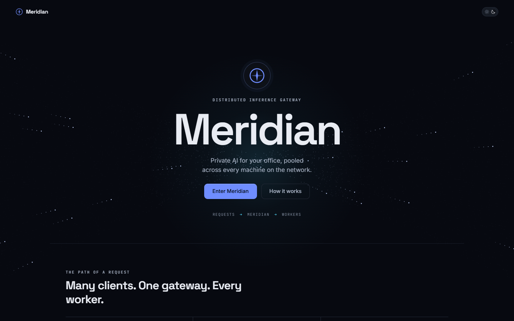
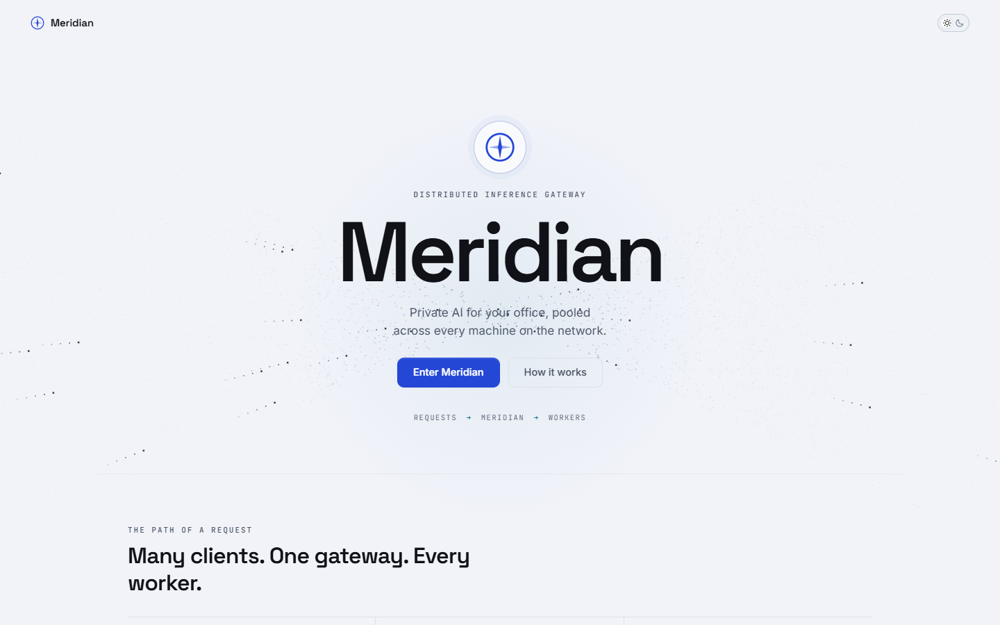
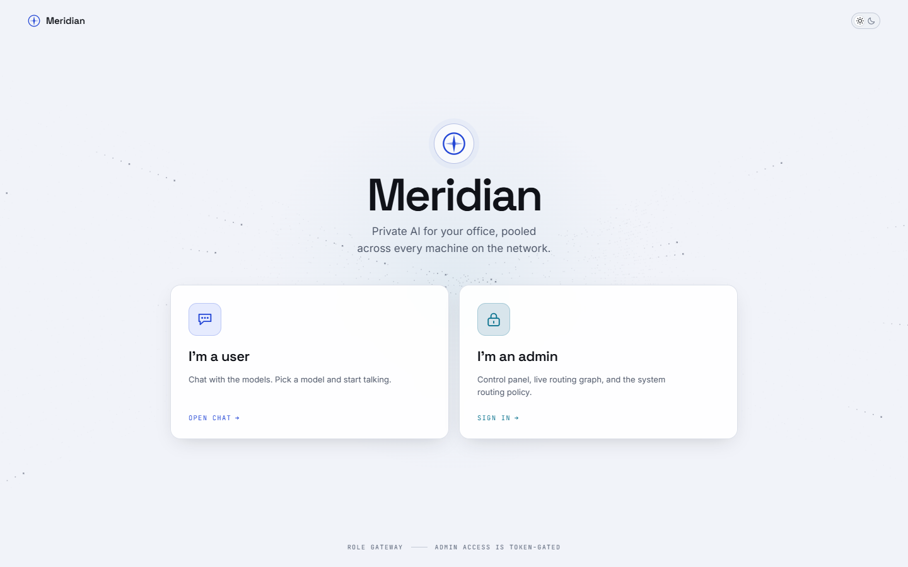
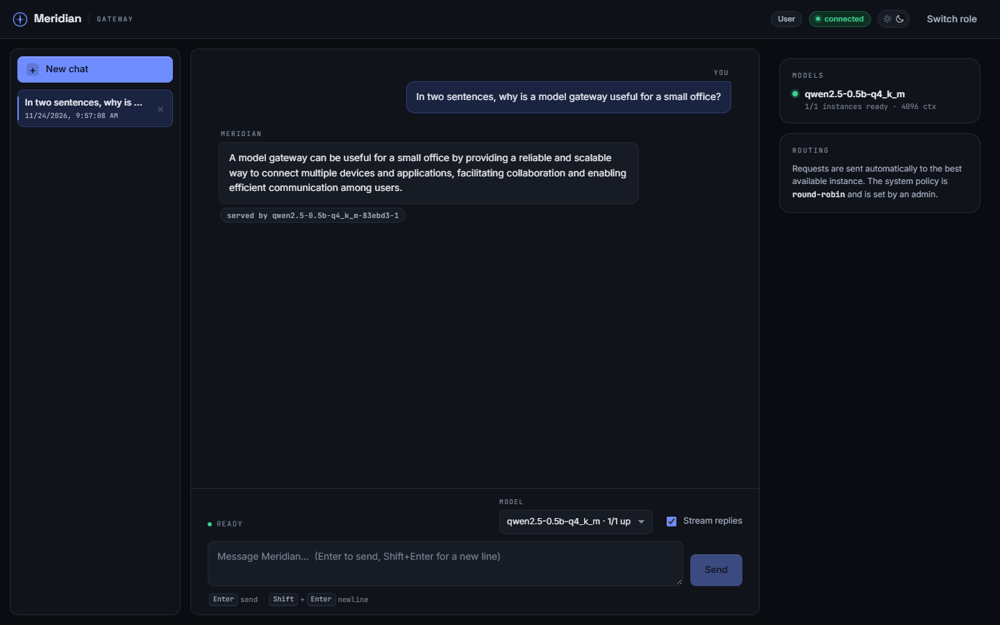
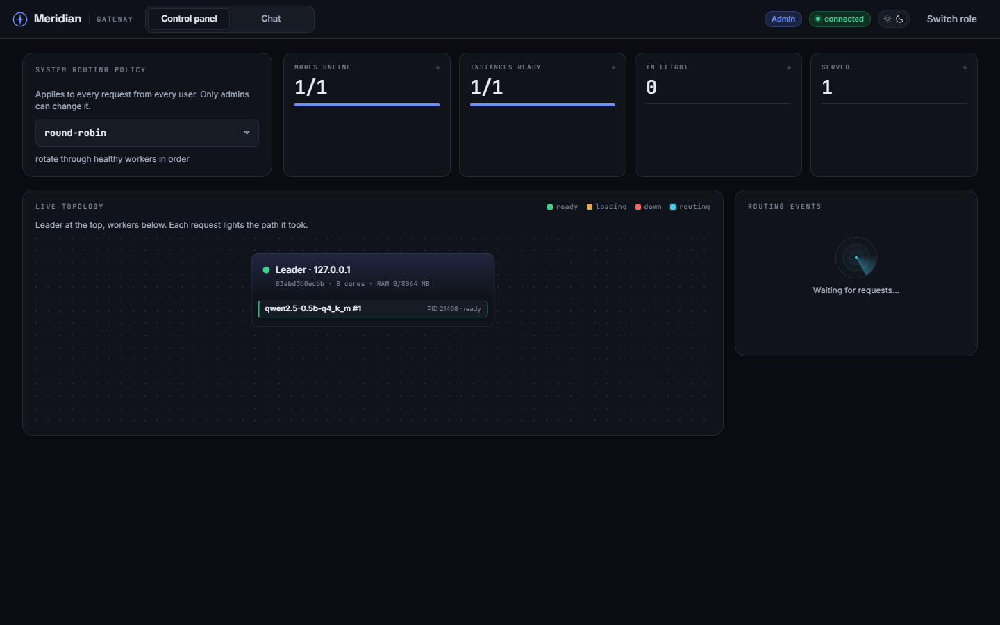
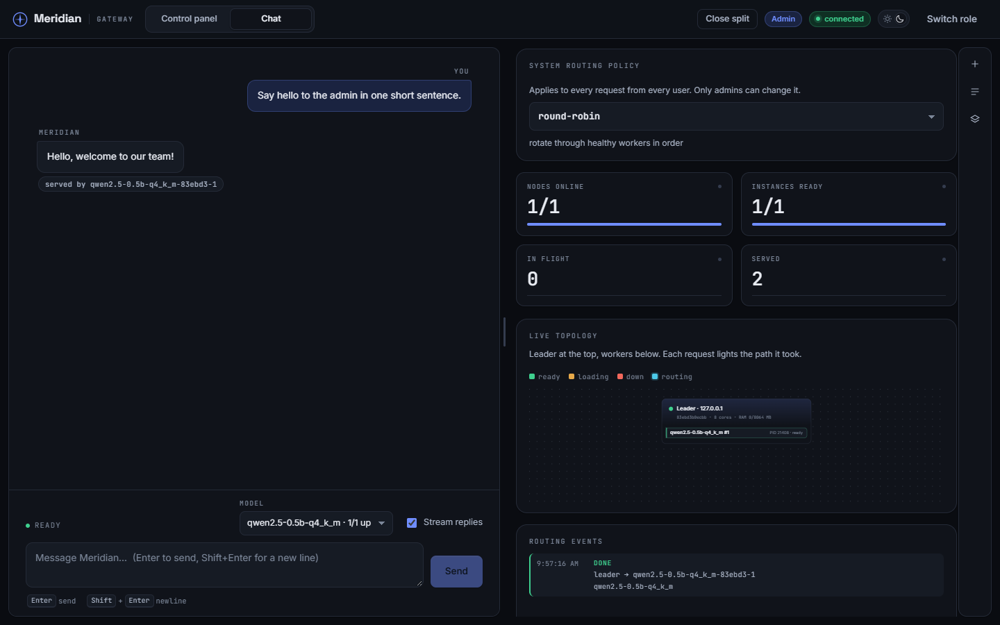
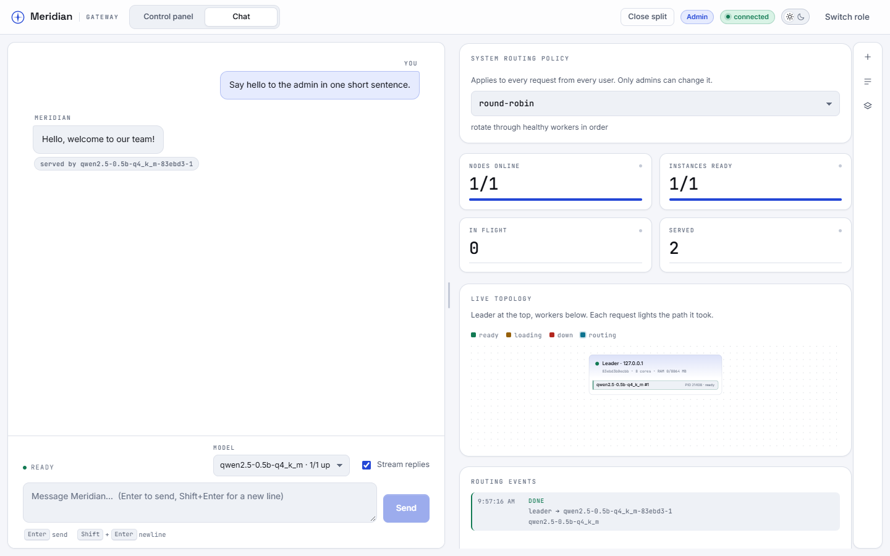
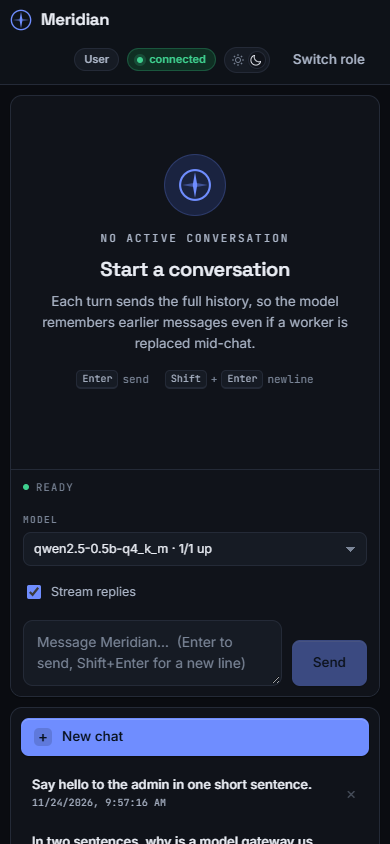

# Meridian UI Redesign — Report

**Date:** 24 November 2026
**Branch:** `experimental`
**Scope:** presentation only — styles, design tokens, presentational components, theme state, and the read-only admin split layout.

---

## 1. Summary

The frontend was restyled around a restrained, instrument-grade visual system rather than a template-driven AI look. The work adds:

- A public **gateway landing page** with a canvas particle-flow animation that converges into a throat and fans back out.
- **Light and dark themes** as equal citizens, with a two-position toggle, OS default, and persistence in `localStorage["meridian-theme"]`.
- A restyled **role gateway**, **chat**, **control panel**, **topology graph**, and **models/routing panel**.
- An **admin split view** (Chat + Control panel side by side) with a draggable, keyboard-operable divider and a compact rail/drawer for conversations and models.
- CSS-only motion throughout, with static equivalents under `prefers-reduced-motion`.

Application logic was not changed: no API calls, SSE/stream handling, routing, session/role rules, stores, types, tests, or backend code were modified. `web/src/api.ts`, `web/src/types.ts`, `useConversations`, and `usePoll` are untouched.

---

## 2. Design system

### 2.1 Tokens

All colour, type, radius, shadow, and canvas values live in `web/src/styles.css` as custom properties. Light values are the `:root` defaults; `[data-theme="dark"]` overrides them. Components never hard-code theme colours, so both themes are first-class.

Key additions:

| Token group | Purpose |
|---|---|
| `--bg`, `--surface`, `--surface-2/3`, `--surface-glass` | page, panel, inset, and blurred-chrome surfaces |
| `--border`, `--border-strong` | hairlines and emphasised rules |
| `--text`, `--text-muted`, `--text-faint` | primary, secondary, and mono-label ink |
| `--brand-1/2/3`, `--accent-soft`, `--on-brand`, `--ring` | signature indigo/cyan accents, selection, focus |
| `--ok`, `--warn`, `--bad` (+ soft variants) | health and state, never used alone to carry meaning |
| `--particle`, `--canvas-bg` | canvas palette read at runtime |
| `--radius*`, `--shadow*` | restrained geometry and elevation |

`--text-faint` was tuned for AA: ≈5.3:1 on the light surface, ≈4.8:1 on inset surfaces, and ≈5.0:1 on the dark surface. `--text-muted` is ≈7.6:1 light and ≈8:1 dark.

### 2.2 Typography

Self-hosted variable fonts via Fontsource, imported once in `web/src/main.tsx`:

- **Inter Variable** — UI and body text.
- **Space Grotesk Variable** — wordmark, headings, display numerals.
- **JetBrains Mono Variable** — technical data: model ids, node addresses, PIDs, timestamps, event phases, stat values, keyboard hints.

No runtime font CDN is used; the build emits the woff2 subsets into `internal/webui/dist/assets`.

### 2.3 Motion

- Entrance stagger on the hero, fade-in for messages/cards, typing dots, stream caret, live-status ping, policy-description fade, radar sweep, packet travel on routing edges.
- The canvas pauses when hidden or offscreen, caps DPR at 2, reduces particle count on small screens, and adapts quality if frames run long.
- `prefers-reduced-motion` disables CSS animation/transition and renders a single static canvas frame.

---

## 3. Screens

### 3.1 Landing page

`LandingPage` sits before the existing role gateway. It never selects a role itself; the Enter action only reveals the existing gateway. The canvas is decorative (`aria-hidden`), fixed behind the content, and reads its palette from the theme tokens.

The page uses a large solid-ink wordmark, one controlled bloom at the throat, a three-step “path of a request” explainer, and a mono footer. Colours are a slate canvas with indigo and cyan accents; there are no gradient text effects and no purple/blue “AI template” washes.

### 3.2 Role gateway

The original two-role choice and the admin token check are unchanged. The cards were restyled as flat, bordered surfaces with a hairline accent that grows on hover/focus, a single icon tile per role, and a mono action line. The dimmed canvas continues behind them at reduced density and opacity.

### 3.3 Chat

- Empty state with the compass mark, explanation, and keyboard hints.
- Assistant messages are inset panels; user messages use the accent-soft panel with a squared corner toward the speaker.
- Streaming caret while content arrives, three-dot typing state before the first token, and real worker/failover badges from the existing response.
- Composer shows a live ready/receiving indicator, model select, stream toggle, and a keyboard-hint row.
- All handlers, history construction, abort/stop behaviour, and metadata remain as before.

### 3.4 Control panel

- Real stat cards only: nodes online, instances ready, in flight, served. Numeric values tween with `useCountUp`; fraction cards render tick marks, and the in-flight card pulses only when the real count is above zero.
- System policy card (admin-only) keeps its select and change handler; the description fades when the policy changes.
- Topology: dot-grid background, leader above workers, routed edges lit from live SSE events, a packet travelling the lit path via CSS `offset-path`, and a replica accent stripe for health.
- Routing events: compact mono rows with phase-coded left rules; the empty state is a slow radar sweep rather than placeholder rows.
- No invented data, models, addresses, or events are shown.

### 3.5 Admin split view

- A `Split view` / `Close split` button is available in the admin Chat tab.
- The split opens automatically after the first message in a conversation, using only the existing message-count state; send/stream handlers were not modified.
- It closes when a new empty conversation is active, and the preference persists in `localStorage["meridian-split"]`.
- Layout: chat left, control panel right, drag/keyboard divider, vertical rail on the right, and drawers for conversations and models/routing.
- Below 1080 px the split stacks vertically and the rail/drawers are hidden; normal console layout also collapses to a single column, with chat first on narrow screens.

---

## 4. Verification

### 4.1 Build and types

```
npm --prefix web run typecheck   # pass
npm --prefix web run build       # pass
```

Production output is written to `internal/webui/dist` and embedded by the Go server as before. Final bundle: `index-D3Ey-B5V.js` (≈263 kB, ≈82 kB gzip) and `index-B6VV2iFk.css` (≈46 kB, ≈12 kB gzip), plus self-hosted font subsets.

### 4.2 Live verification

Screenshots were captured from a real leader node serving the freshly built UI:

```
meridian-server-ui.exe serve --leader \
  --admin-token <token> --cluster-secret <secret> \
  --host 127.0.0.1 --port 8095 \
  --control-port 8196 --discovery-port 8197 --replica-port-base 8200 \
  --advertise-ip 127.0.0.1 --ram-headroom-mb 128 \
  --enable-ml=false --enable-llm=true \
  --llm qwen2.5-0.5b-q4_k_m.gguf
```

- One local replica (`qwen2.5-0.5b-q4_k_m`) was healthy on loopback.
- Chat and split-view screenshots contain answers from live requests to that replica.
- Control-panel screenshots show the real node, replica, PID, policy, stats, and routing event produced by those requests.
- Headless Chrome reported **no page errors and no console errors**.
- Horizontal overflow checks returned `scrollWidth === innerWidth` at **1920, 1440, 390, and 360 px**.
- Both themes were exercised on every major screen.

### 4.3 Pre-existing Go test baseline (not caused by this work)

`go test ./...` on Windows still fails only in the same two Linux-oriented tests recorded before the UI work:

- `internal/ml/supervisor_test.go` uses `syscall.Kill`, which does not exist on Windows.
- `internal/config/config_test.go` expects `0600` file modes; Windows reports `-rw-rw-rw-`.

No Go application source was changed by this UI work.

---

## 5. Screenshot index

All images are in `docs/ui-redesign/`.

| # | File | View | Theme |
|---|---|---|---|
| 01 | [01-landing-dark.png](01-landing-dark.png) | Landing | Dark |
| 02 | [02-landing-dark-full.png](02-landing-dark-full.png) | Landing, full page | Dark |
| 03 | [03-landing-light.png](03-landing-light.png) | Landing | Light |
| 04 | [04-role-gateway-dark.png](04-role-gateway-dark.png) | Role gateway | Dark |
| 05 | [05-role-gateway-light.png](05-role-gateway-light.png) | Role gateway | Light |
| 06 | [06-chat-empty-dark.png](06-chat-empty-dark.png) | Chat, empty | Dark |
| 07 | [07-chat-empty-light.png](07-chat-empty-light.png) | Chat, empty | Light |
| 08 | [08-chat-streaming-dark.png](08-chat-streaming-dark.png) | Chat, streaming | Dark |
| 09 | [09-chat-answer-dark.png](09-chat-answer-dark.png) | Chat, answered | Dark |
| 10 | [10-chat-answer-light.png](10-chat-answer-light.png) | Chat, answered | Light |
| 11 | [11-admin-signin-dark.png](11-admin-signin-dark.png) | Admin token gate | Dark |
| 12 | [12-control-panel-dark.png](12-control-panel-dark.png) | Control panel | Dark |
| 13 | [13-control-panel-dark-full.png](13-control-panel-dark-full.png) | Control panel, full page | Dark |
| 14 | [14-control-panel-light.png](14-control-panel-light.png) | Control panel | Light |
| 15 | [15-split-streaming-dark.png](15-split-streaming-dark.png) | Split view, streaming | Dark |
| 16 | [16-split-dark.png](16-split-dark.png) | Split view | Dark |
| 17 | [17-split-light.png](17-split-light.png) | Split view | Light |
| 18 | [18-split-divider-hover-dark.png](18-split-divider-hover-dark.png) | Divider affordance | Dark |
| 19 | [19-landing-mobile-dark.png](19-landing-mobile-dark.png) | Landing, 390 px | Dark |
| 20 | [20-role-gateway-mobile-dark.png](20-role-gateway-mobile-dark.png) | Role gateway, 390 px | Dark |
| 21 | [21-chat-mobile-dark.png](21-chat-mobile-dark.png) | Chat, 390 px | Dark |
| 22 | [22-landing-1920-dark.png](22-landing-1920-dark.png) | Landing, 1920 px | Dark |
| 23 | [23-landing-360-dark.png](23-landing-360-dark.png) | Landing, 360 px | Dark |
| 24 | [24-role-gateway-360-dark.png](24-role-gateway-360-dark.png) | Role gateway, 360 px | Dark |

### Key frames

**Landing, dark**



**Landing, light**



**Role gateway, light**



**Chat, dark, live answer**



**Control panel, dark**



**Admin split view, dark**



**Admin split view, light**



**Chat, 390 px**



---

## 6. Files

### Added

- `web/src/components/BrandMark.tsx` — compass mark.
- `web/src/components/GatewayCanvas.tsx` — raw Canvas 2D particle gateway.
- `web/src/components/LandingPage.tsx` — public landing page.
- `web/src/components/ThemeToggle.tsx` — two-position theme switch.
- `web/src/hooks/useTheme.ts` — theme state, persistence, pre-paint adoption.
- `web/src/hooks/usePrefersReducedMotion.ts` — motion preference.
- `web/src/hooks/useCountUp.ts` — presentational stat tween.
- `docs/ui-redesign/REPORT.md` and the 24 screenshots above.

### Modified (presentation only)

- `web/src/styles.css` — full token system and component styles.
- `web/src/App.tsx` — theme wiring, landing gate, split view, rail/drawers, segmented tabs. Send/stream/history code unchanged.
- `web/src/components/Landing.tsx` — role gateway restyle; role/token logic unchanged.
- `web/src/components/ChatPanel.tsx` — chat restyle; handlers unchanged.
- `web/src/components/AdminPanel.tsx` — stat cards, event empty state, policy description fade; data logic unchanged.
- `web/src/components/ClusterGraph.tsx` — topology styling and packet animation; geometry/lit logic unchanged.
- `web/src/main.tsx` — font imports.
- `web/index.html` — inline no-flash theme script and metadata.
- `web/package.json`, `web/package-lock.json` — three Fontsource packages.
- `internal/webui/dist/**` — rebuilt production bundle.

### Explicitly untouched

`web/src/api.ts`, `web/src/types.ts`, `web/src/hooks/useConversations.ts`, `web/src/hooks/usePoll.ts`, `web/src/components/ModelsPanel.tsx` (markup unchanged; restyled via CSS), all Go source, configuration, and tests.
